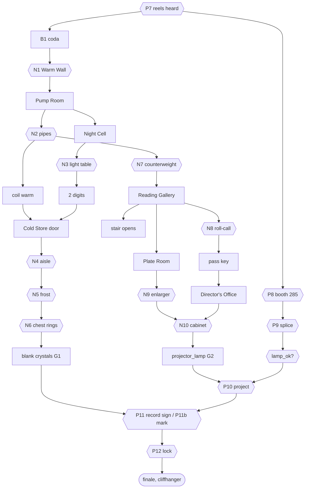

# Chapter 2 expansion — "The Whole Building" (design proposal)

**Status:** owner decisions recorded 2026-11-01 (section 17). The **logic** is implemented and tested (`game/src/rooms/archive/archive_exp_data.gd`, `archive_logic.gd`, `tests/test_archive_exp_*.gd`); scenes, models, audio and hands are not yet. Written 2026-11-01.
**Scope:** Chapter 2 (`docs/CHAPTER2_DESIGN.md`, `game/src/rooms/archive/`) grows from one hall with a booth and a vault into a small multi-floor building. No code, models or strings are changed by this document.
**Hard rules kept:** calm, fair, logical, tactile; one-finger tap/drag; room-view navigation (no free walking); no enemies, no chase, no gore, no jump-scare spam; EN/RU/UZ through `tr()`; language-neutral solutions; per-game variants (`docs/VARIANTS.md`); offline; rating 7+/9+. Nothing from any other game is reused (no dice/board theme, no hooded host, no shop upgrades).

## 1. Goals, length, and how it was estimated
Owner feedback: free content is too short; Chapter 2 has one big room before the cliffhanger. Goals:
1. A real "explore a building" feeling: several floors, 7 explorable rooms (6 new), two lifts/stairs, a plan to travel with.
2. Variety: the new puzzles use mechanics the chapter does not have yet (deduction grid, balance, wipe-reveal, stacked transparencies) beside reused signature ones.
3. A new area opens every 5-8 minutes, so there is always a next door.
4. Short scripted "reaction moments" and a tactile hand-held item layer, both optional in Settings.
5. Chapter 3 continuity is untouched (same `ch2_key`, `ch2_echoes`, cliffhanger).

**Target length (average first-time player):** Chapter 2 today about 30-40 min (the design doc's own target; it was never timed with humans, only bot-played: 85-94 taps in `qa/playthrough_ch2.tscn`). Target after the expansion: **65-85 min** (Stage A alone: 50-60 min).

**Estimate method (rough, +-30%):** the existing 12 puzzles at 30-40 min = 2.5-3.3 min each including walking and reading. New puzzles are mid-to-late difficulty, so each is rated 1.0-1.6x that, then room overhead (first look, documents, captions at `UITheme.read_seconds` = 1.2 s + length/12 chars/s, travel) is added at 15-20%. Table in section 6. **This must be replaced with measured numbers from 5 human playtests before the owner promises a length.**

## 2. Canon relied on (and what must not be broken)
| Canon | Source | Consequence for the expansion |
|---|---|---|
| Leyla lived secretly in the archive 1996-98; the archive "still breathes" (tubes, lamps, vault) | `CHAPTER2_DESIGN.md` Story, Leyla's 1998 letter | The Night Cell is her home. Warm pipes, a kettle, a cot are consistent |
| She hid reels with beacons only her pocket receiver hears; tape 1998 says "the way down is inside" | same | The new door is found with the same receiver (a coda on the 1998 reel). "The way down" still means the vault's lift |
| Strand kept 41 people; the 42nd silhouette (Leyla, 1998) is revealed by the vault reel | STORY, `ENGAGEMENT.md` | **No new content may state or count 42.** The roll-call horn stops after 41 and says nothing more |
| Strand's diagnosis (1977 letter) and "My heart keeps the count" are Chapter 3 reveals | `CHAPTER3_DESIGN.md` | The Director's Office shows his work and care, not his illness |
| The 1979-postmarked parcel is explained only by Chapter 4's secret (M19, post into the past) | `CHAPTER4_DESIGN.md` | The Records counter never explains postmarks. Stamps read only RECEIVED |
| Pneumatic destinations 0 Director, 1 Stacks, 2 Labs, 3 Booth, 4 Records, 5 Vault (sealed); Chapter 4 reuses the pictogram set | `archive_logic.gd` `DEST_COUNT`, `CHAPTER4_DESIGN.md` | Keep the six pictograms. Dest 0 and 4 get real receivers in Stage B; 2 and 3 stay "no receiver", 5 stays sealed |
| Lab 7 has a child's drawing (Leyla's daughter Mira, `GLOSSARY.md`) | STORY | A copy of the drawing hangs over the cot. No new fact about Mira |
| Chapter 3: freight lift from the vault to Level -2; epilogue "Somewhere below, a recorder clicks on" | `CHAPTER3_DESIGN.md`, `archive_teaser.gd` (`SHAFT_*`) | The new floors are "Level -1 / +1" of the archive annex; the small **book lift** is a different, wooden cage in a different shaft. Freight shaft and teaser untouched |
| `choices.ch2_key`, `choices.ch2_echoes` (0-3) are read by Chapters 3-4 (`underground_logic.gd` `setup_from_profile`, `array_hall_logic.gd`) | code | `ECHOES` stays 3. New echoes are a separate counter. Secrets need `ch2_echoes >= 3` and `ch1_shards >= 5`: unchanged |
| `Chapters.LIST`: ch2 free; ch3 `released: true` for testers but needs `full_game` | `core/chapters.gd` | Brief said "not released": the code flag is for closed testers, payments are off. No change here |

## 3. The building: floor plan, connections, navigation
"Archive Annex B" of the Meridian Institute. Each floor is a *zone* of the one Godot scene, placed away from the others (like the booth, which is culled when out of view) so floors never overlap the freight shaft. "Floor" is a narrative label, not geometry.

```
LEVEL +1  [Reading Gallery]--(door, pass key)--[Director's Office]
              |  balcony over hall      [Plate Room]--(door)--+
              |  spiral stair (wedge)   ^ book lift (arrives)
LEVEL  0  [ARCHIVE HALL + booth + vault]  (existing, R1)
              |  warm east wall (service door)
LEVEL -1  [Pump Room]--[Night Cell]--(insulated door)--[Cold Store]
              ^ book lift cage (selector + counterweight)
(Level -2 = Chapter 3, via the freight lift under the vault)
```
| # | Room | Floor | New? | Stage | Purpose / mood |
|---|---|---|---|---|---|
| R1 | Archive hall (+ booth, vault) | 0 | existing | - | Hub. Gets: a service door, a stair stump, a floor plan on the wall. No new heavy geometry |
| R2 | Pump Room | -1 | new | A | Boiler, manifold, work lamp. Warm, loud, orange. Hub of the lower floor |
| R3 | Night Cell | -1 | new | A | Leyla's room. Amber, quiet, human. Cot, kettle, desk with light table, drawing of Mira |
| R4 | Cold Store | -1 | new | A | Film cellar. Blue-white, frost, breath. Compactus, frosted window, chest |
| R5 | Reading Gallery | +1 | new | B | Balcony over the hall, records counter, wall of speakers (old PA horn). Dusty daylight |
| R6 | Plate Room | +1 | new | B | Photographic darkroom, red safelight (visual rhyme with Chapter 1's darkroom, different layout) |
| R7 | Director's Office | +1 | new | B | Strand's room: orderly, brass, cold tea for two. Spare projector lamp cabinet |
Transit views (not rooms): spiral stair, book-lift cage. Stretch room R8 "lift machine room under the vault" is **not** proposed: it would explain the cliffhanger's motor too early. Keep it for a Chapter 3 prologue.

**Connections**
| From - To | How | Gate |
|---|---|---|
| Hall - Pump Room | Service door in the east wall south of the compressor, short stair down | N1 Warm Wall |
| Pump Room - Night Cell | Plain door (she lived here) | none |
| Night Cell - Cold Store | Insulated door (a wheel lock, 2 digits, and a heating coil) | N2 (thaw) and N3 (digits) |
| Pump Room - Gallery | **Book lift** (goods lift, wooden cage), floors -1/0/+1 | N7 counterweight |
| Hall - Gallery | **Spiral stair**, blocked by a wedged ladder at the landing: *collapsed route, go around* | Opens from above: pull the wedge pin on the Gallery side (a beat, no puzzle). Then both directions are open |
| Gallery - Director's Office | Door with a pass key | N8 roll-call board gives the key |
| Gallery - Plate Room | Plain door | none |
| Book lift - Hall (0) | The lift also stops at the hall's service door | after N7 |

**Navigation UI (no new HUD corner).** The floor plan is a **document item** `floor_plan` in the bag from the start, like the notebook: tapping it opens an overlay (floors as three stacked strips -1/0/+1, rooms as tiles, visited rooms lit, locked doors shown with a padlock). Tapping a lit tile travels there with a 0.4 s cross-fade (fast travel only to visited rooms, so QA finding "too much walking" is answered). The same plan hangs in the hall as a view `plan`. Keeps `HUD.blocked_rects()` unchanged; the overlay is hidden while a banner or caption is running, like the notebook. Needs the hud-check to cover the overlay's tiles (section 12).

## 3b. Design pillar: wander, notice, come back
Why many rooms: with one or two rooms the player circles the same walls. With many, they notice "this was locked", "this clue belongs somewhere else", walk back and re-check. That small detective loop is the content, so it is designed, not left to chance.

**(1) Every room looks and feels different.** One line each; the mood reference is in words only (no other game).
| Room | Visual identity | Palette / light | Ambience | Signature object | Mood in words |
|---|---|---|---|---|---|
| R1 Hall (existing) | Institutional green tile, pendant lamps, glass tubes | pale green, cream, brass; enamel pendants | tube hiss, dust-tick | pneumatic station | a hospital corridor after closing |
| R2 Pump Room | Iron, rivets, wet floor | orange-black, one swinging work lamp | boiler roar, drips, pipe knocks | the manifold with six wheels | a ship's engine room at night |
| R3 Night Cell | A tiny home | amber 2700 K lamp, wool and wood | kettle tick, soft pipe hum | the light table on the desk | a grandmother's attic, kept warm |
| R4 Cold Store | Steel racks, frost | blue-white, breath mist | still air, ice creak, deep carriage rumble | the compactus carriages | a cathedral made of shelves |
| R5 Reading Gallery | Dust, daylight, wood, balcony | sepia daylight shafts, long shadows | PA horn hiss, distant hall echo | the roll-call board | a closed library on a Sunday |
| R6 Plate Room | Trays, red safelight | deep red, black | water drip, fan | the enlarger | a quiet confession box |
| R7 Director's Office | Order, brass, leather | cool white with one green desk lamp | clock-less silence, faint tube tap | the cabinet with four wheels | a headmaster's study kept as it was |
Rule: no two rooms share a dominant colour *and* a sound bed. Each room has its own ambience loop and one new prop type the others lack, so a screenshot of any room is recognisable. This is a review item in section 14.

**(2) Intentional backtracking loops.** A "thread" is something seen that cannot be finished yet. Seed them early, pay off later, and put the clue in a *different* room than the lock.
| Thread (seen first) | Seen in | Paid off in | Gap |
|---|---|---|---|
| Frozen insulated door with a wheel lock and a coil | Cell | Pump Room (thaw) + Cell desk (digits) | 5-8 min |
| Warm east-wall panel, needle rising | Hall | Pump Room (door found) | 0 |
| Dead booth case with a card "kept below" | Booth | Cold Store chest (crystals) | 15 min |
| Blocked spiral stair, wedged ladder | Hall | Gallery (wedge pin from above) | 20 min |
| Dead projector lamp | Booth | Director's Office cabinet | 15 min |
| Locked pass door with a keyhole shaped like the roll-call tag | Gallery | Gallery board (same room, 2 min) and Records counter | 2 min |
| Mira's drawing on the cot (echo of Lab 7) | Cell | Epilogue line only (pure atmosphere) | - |
| Meridian emblem stencil on the chest lid | Cold Store | Slide cabinet in the booth (leave path), a small callback | 10 min |
| Strand's cabinet label symbol | Office | Plate Room negatives (symbol match) | 5 min |
| Roll-call tags | Gallery | Plate Room photos (faces on the prints match the tags) | 5 min |
Clue echoes across floors: the same symbol set (frost signs, tag icons, the six pneumatic pictograms) reappears so a player can recognise "I have seen this" without reading text.
**Rule of thumb for open threads:** the player never holds more than **3 open threads** at once; a 4th is only introduced after one closes. Every locked thing is opened within about 10-15 minutes of first being seen, and its clue and its lock are at most **two rooms** apart. At most one thread per floor is "long" (> 10 min); the rest close in minutes. Pacing in section 6 was checked against this.

**(3) Navigation support so wandering is never frustrating.**
- **Floor plan** (section 3): spoiler-free markers per room: *visited* (lit), *new* (never entered, dot), *open item here* (a small lock-with-key icon on rooms that contain an unsolved lock or a pick-up the player has not taken), *locked* (padlock on doors). Markers say *that* something is pending, never *what*. They are computed from state, e.g. `room_pending(room)`, tested for no leak (they must not appear for a puzzle whose clue the player has not met yet).
- **Quick travel** from the plan only to rooms the player has already entered (first visit is always on foot through the door), 0.4 s cross-fade, never into a locked room. Travel is also offered as a one-line "Go to <room>" from the hint dialog.
- **"Next step: place"** (`HintPlaces`) names a room for every new goal (`c2x_*`), so hint level 1/2 can say *where* without saying *what*.
- **Notebook page "Open threads"** (a new page of the Leyla notebook-style document, used here as the `floor_plan` overlay's second tab): each open thread as one pictogram line plus the room icon where it was seen ("a frozen door", "a dead lamp", "a blocked stair"). No solution text. A thread leaves the list when closed.
- The caption on first sight of a locked thing is short and states the *obstacle*, not the fix (for example "The door is frozen shut.").

**(4) Avoid tedium (review checklist; any "no" blocks the room).**
1. No fetch-quest padding: no "bring item A to room B to get item C" without a puzzle or a discovery in between. Every item carried across floors has a real use and a moment of surprise at the destination.
2. No pixel hunts: every pick-up is a visible object, reachable in its view, or found by the receiver's needle (an existing, learned tool), and a flashing "has item" marker on the plan if missed.
3. Every walk reveals something: each trip between rooms passes a view with a new detail, a caption, a changed prop or a moment (section 11); a return trip shows what changed (lit lamp, open door).
4. At most 2 room changes between a clue and its lock for the same thread.
5. Travel never costs more than 3 taps (plan, tile, done).
6. No timers, no re-doing: solved puzzles stay solved; nothing resets when the player leaves a room.

## 4. New story beats (placed before the existing cliffhanger)
| Beat | Where | Text (EN, canonical; RU/UZ in `strings_ch2.py`) | Sits after |
|---|---|---|---|
| B1 Coda | Tape deck, after the 3rd reel | *"If you are still listening: my door is where the pipes are warm. The needle will find it. My number opens it."* | P7 |
| B2 The cell | Night Cell | Cot, kettle still ticking as if cooling, a child's drawing copy. Diary page: *"Day 700. The pipes sing at night. I count the names so I do not forget I am a person."* | N1 |
| B3 Light table | Night Cell | Pencil on the lamp: *"Three layers. Only the true one lets the light through."* | N3 |
| B4 Cold Store | Cold Store | Cans labelled by year; a note: *"Crystals fog in warm air. I keep them where film keeps."* (explains why the blanks moved) | N4 |
| B5 Roll call | Gallery horn | A 1979 roll call fades in: names (no text), ending *"...forty."* *"...forty-one."* then hiss | arrival B |
| B6 Director's Office | Office | Two cups of cold tea, Strand's neat note: *"For L. when she returns. The lamp is in the cabinet."* (shows he expected her; fits "not a villain") | N8 |
| B7 Lamp | Booth | Projector lights; film plays as today | N10 |
Everything else (film, recording, vault, 42nd silhouette, key choice, cliffhanger) is unchanged and still the ending.

## 5. How the expansion gets on the critical path (and stays optional where it should)
Two real gates, both story-logical, both with a legacy bypass (section 10):
- **G1 (Stage A): the blank crystals moved from the booth's lens case to the Cold Store chest** (B4: "crystals fog in warm air"). `SPOTS["case_crystal_1/2"]` (`archive_logic.gd`) gain the need `crystals_available`. Both paths need at least one blank crystal (the take path records the sign; the leave path records both), so nobody skips it. Booth case shows a card pointing below.
- **G2 (Stage B): the projector's lamp is dead.** P10 ("Film projector") needs `lamp_ok`; the spare is in the Director's cabinet (N10). The booth projector's lever gives a dull tick and a caption until then.
Stage A alone ships with G2 pre-satisfied (`EXPANSION_STAGE = 1`), so 1.1 is a complete game.

## 6. Pacing and time (new content, average player; minutes are estimates)
| Time (cumulative, Stage A+B) | Unlock / event | Min added |
|---|---|---|
| 0-25 | Existing P1-P7 (Acts A-B) | 0 |
| ~27 | **N1** Warm Wall -> Pump Room (new area 1) | 3 |
| ~31 | **N2** Pipe routing, mallet tapping (thaws the Cold Store coil) | 4 |
| ~36 | Night Cell (area 2), **N3** Light table (new mechanic) | 6 (+3 reading) |
| ~46 | Cold Store (area 3), **N4** Carriage aisle | 4 |
| ~51 | **N5** Frost window, **N6** Chest rings -> crystals (G1) | 2 + 3 |
| ~55 | Stage A subtotal about +25 min -> chapter about 55-60 min | 25 |
| ~58 | Booth branch P8-P9 (existing, parallel). Dead lamp found | 0 |
| ~62 | **N7** Book lift -> Reading Gallery (area 4), roll-call horn | 4 |
| ~68 | **N8** Roll-call board -> Director's key; Plate Room (area 5) | 4 |
| ~73 | **N9** Enlarger -> code; Director's Office (area 6), **N10** cabinet -> lamp | 4 + 3 |
| ~78 | P10-P12, finale as today | 0 |
| | Stage B subtotal about +20 min (incl. reading/travel). **Chapter total about 65-85 min** | |
Every 5-8 minutes there is a new door or floor. Branches are parallel (booth P8-P9 || lower floor; Plate Room || roll-call board), so a stuck player always has another thing to try.

## 7. Areas: views, hotspots, art reuse, budgets
Draw-call numbers are **budgets to be measured** (`tap_map --perf`), not measurements. Limits: 150 draw calls, 150k visible triangles (`docs/ARCHITECTURE.md`). The hall is already at about 133 with the HUD (`QUALITY_REPORT.md`), so the hall gets at most +6 (service door, plan, stair stump). Every new room is a culled zone; props are merged per group with `ModelUtil.merge_static` as the hall's were. HUD adds 3-8 calls.
| Room | Views (camera ids) | Hotspots | Reuse | New Blender models (rough tris) | Draw-call budget | Effort |
|---|---|---|---|---|---|---|
| R1 hall changes | `east_south`, `plan`, `stair` | 3 wall panels, service door+dial, plan, stair stump | hall kit, `rotary dial` from the booth door | `service_door` (2.5k), `stair_stump` (3k), `floor_plan_frame` (1k) | +6 (hall <= 140) | S |
| R2 Pump Room | `pump`, `manifold`, `boiler`, `lift_door` | 6 valve wheels, pipe segments (tap), book-lift gate | pipe/valve kit from compressor panel, lamps | `room_pump` (12k), `boiler` (6k), `manifold_plate` (3k), `valve_wheel` x6 instances, `pipe_run` (5k), `book_lift_cage` (6k), `mallet` (1k) | <= 90 | M |
| R3 Night Cell | `cell`, `desk_light`, `cot`, `shelf` | light table, 3 sheets, kettle, cot, diary, drawing | lamp/desk/books kit, `echo`-free | `room_cell` (8k), `cot` (3k), `light_table` (4k), `acetate_sheet` x3 (0.2k each, decals), `kettle_hotplate` (3k) | <= 80 | M |
| R4 Cold Store | `cold`, `rail_end`, `aisle`, `frost`, `chest` | 5 cranks, end plan, frosted window, chest rings, cans | shelf/can kit from the stacks, `film_reel` | `room_cold` (10k), `carriage` x5 (merge per carriage, 2k each), `frost_window` (1k + shader), `cold_chest` (4k), `film_can` x4 | <= 95 | L |
| R5 Reading Gallery | `gallery`, `balcony`, `counter`, `board`, `horn` | wedge pin, roll-call board, tube terminal, horn | stacks, banker's lamp, tube station | `room_gallery` (12k), `roll_board` (4k, 6 tag instances), `pa_horn` (2k), `balcony_rail` (3k) | <= 100 (looking down at the hall uses a baked card, not the live hall) | L |
| R6 Plate Room | `plate`, `enlarger`, `trays` | enlarger head/focus/negative holder | red-light shader from Chapter 1's darkroom, focus ring from the projector | `room_plate` (7k), `enlarger` (5k), `negative_strip` x4 (0.3k) | <= 75 | M |
| R7 Director's Office | `office`, `cabinet`, `desk` | pass door, 4-wheel cabinet, tea cups | desk/chair/lamp from Lab 7 | `room_office` (8k), `strand_cabinet` (4k), `tea_set` (1k) | <= 85 | M |
New items: `floor_plan`, `mallet`, `wipe_cloth`, `acetate_a/b/c`, `cell_diary`, `frost_sketch`, `crystal_blank_*` (reused), `weights` (4), `pass_key`, `projector_lamp`. Items stay original; any third-party asset goes to `docs/ASSET_LICENSES.md`. Textures: decals via `tools/textures/make_decals_ch2.py` style generators (pipe diagrams, sheets, frost mask, roll-call board).
New models obey the Blender naming rule (`tools/blender/check_glb_names.py`: no `_wheel`, `_col`, `-noimp` etc. endings) and the pivot contract of `docs/models/ch2.md`. Parts listed above need a new `docs/models/ch2_exp.md` contract.

## 8. New puzzles (10)
Existing 12 stay unchanged. **One genuinely new mechanic: M14 Light table** (N3). N7 (balance) and N8 (deduction) are new *puzzle types* built from tap-toggle parts, not engine mechanics; the owner may refuse them (question 3). N5 is a drag/tap reveal related to Chapter 1's UV reveal (M3).
| # | Stage | Room | Name | Mechanic | Min | Effort |
|---|---|---|---|---|---|---|
| N1 | A | R1 | Warm Wall | M3 receiver reused + dial | 3 | S |
| N2 | A | R2 | Pipe routing | Panel 7 switch logic + M5 routing idea, mallet beat | 4 | M |
| N3 | A | R3 | Light table | **M14 new**: stacked transparencies | 6 | L |
| N4 | A | R4 | Carriage aisle | sliding with gaps (gear-box idea) | 4 | M |
| N5 | A | R4 | Frost window | wipe-reveal (M3 layer) | 2 | S |
| N6 | A | R4 | Chest rings | Strand's "neighbour follows" gear rule | 3 | M |
| N7 | B | R2 | Book-lift counterweight | balance with 1-2-4-8 weights | 4 | M |
| N8 | B | R5 | Roll-call board | pictogram deduction grid | 4 | M |
| N9 | B | R6 | Enlarger | M1 + focus/zoom (reuses P10 focus, P12 zoom) | 4 | M |
| N10 | B | R7 | Strand's cabinet | 4 digit wheels (Chapter 1 drawer) | 3 | S |

### N1 Warm Wall (hot/cold + dial)
- **Inputs:** receiver (M3) in the `east_south` view; three painted panels A/B/C; a rotary dial on the revealed door.
- **Rule:** receiver strength per view comes from `RECEIVER_TABLE`-style data (new target `cell_door`). The strongest panel hides the door plate. Dial **0417** (Leyla's staff number, a story anchor, same as the badge).
- **Variant:** `v_panel` in {A,B,C}, drawn from the seed. The receiver table rows move with it.
- **Failure:** wrong dial digits reset after 4 digits with the dull "no" click already used by the booth dial.
- **Hints:** (1) The coda said her door is warm. (2) Select the receiver and watch the needle along the east wall. (3) Panel {X}, then dial 0, 4, 1, 7.
- **Clues:** tape coda B1, the badge (number), the receiver.

### N2 Pipe routing (+ mallet tapping)
- **Inputs:** 6 valve wheels on the manifold; pipe segments (tap with the mallet).
- **Rule:** the diagram is a small graph: source S (compressor stub), target C (Cold Store coil), hazard H (vent to the hall: it must stay dead, the same rule as Chapter 1's VENT lamp). Each valve opens one edge. Success when S reaches C and H is not reached. A pipe the flow reaches glows warm and ticks.
- **Mallet beat (H2):** tapping a segment plays a pitch: full/charged = low, dead = high, cracked = buzz. It is a free probe that shows where the flow stands, so the puzzle can be solved by probing as well as by reading the diagram.
- **Variant:** `v_pipes` = one of 6 verified graphs, drawn as geometry toggles; each has exactly one shortest solution (checked by brute force over 2^6).
- **Failure:** a wrong route lights H's warning lamp and hisses; nothing is lost.
- **Hints:** (1) The Cold Store door is frozen shut. (2) Warm pipes must reach the coil; the hall vent must stay cold. (3) Open valves {list}.

### N3 Light table (M14, the new mechanic)
- **Parts:** a lightbox with a 7 x 11 cell window; 3 acetate sheets (tap a sheet to rotate 90 degrees; tap its flip tab to flip). One-finger only.
- **Rule:** light passes a cell only if it is transparent on all three sheets. Lit cells form two digits (5 x 7 font). Order of stacking does not matter (AND is commutative); each sheet has 4 rotations x 2 flips.
- **Fairness:** each sheet is the target glyph cells plus its own "noise" opaque cells that the other two sheets cover only in the correct orientation. Live feedback: the lit area grows as sheets align. A tiny arrow on each sheet and corner marks on the box fix the reference.
- **Variant:** `v_glyph` (2 digits, from {1,2,3,4,5,7}: no 0, 6, 8, 9 because rotation makes them ambiguous) and the noise masks. A generator rejects any set where another orientation also lights a legible digit pair (brute force 8^3 = 512 states).
- **Output:** the two digits open the Cold Store door's wheels.
- **Failure:** wrong wheels just do not release (no consequence).
- **Hints:** (1) Light passes only where nothing blocks it. (2) Stack all three sheets and turn them until the light draws numbers. (3) Orientations {r,f}x3; the digits are {D1}{D2}.

### N4 Carriage aisle
- **Parts:** 5 compactus carriages on rails with 7 slots (2 gaps); one crank per carriage; a plan plate on the end panel.
- **Rule:** a crank slides its carriage one slot into an adjacent gap, otherwise it clunks. An aisle is open where a gap sits between two carriages. The chest sits behind the carriage whose end tag matches the stencil on the plan. Wrong aisles show other shelves with lore cans (and the echo moment, section 11).
- **Variant:** `v_bay` (1-4) and a start arrangement from a pool where the shortest route is >= 5 cranks. All 21 arrangements are connected (tested), so nothing can lock.
- **Hints:** (1) The chest is behind a shelf. (2) The plan shows which carriage hides it. (3) Open the aisle left of carriage {k}: cranks {sequence}.

### N5 Frost window (wipe reveal, cloth beat)
- **Parts:** frosted pane with three horizontal bands; the cloth item. Drag with one finger to wipe, or tap a band to wipe it (accessible alternative).
- **Rule:** under each band Leyla finger-wrote one symbol (left to right). The three symbols form the chest target. Once all are seen, a `frost_sketch` item stores them (re-readable; fog does not matter later).
- **Variant:** `v_symbols`, 3 of 6 distinct symbols (the Chapter 3 drum set, drawn as art, not text).
- **Hints:** (1) The window is covered in frost. (2) Wipe it with the cloth, each band hides a sign. (3) Signs: {a}{b}{c}.

### N6 Chest rings
- **Parts:** 3 symbol rings of 6; the lid inscription "Turn one and its neighbour follows" (Strand's gift box rule from notebook p.3, same coupling as the Chapter 1 gear box: turning ring i also turns ring i+1 mod 3 one step).
- **Rule:** set the rings to the frost sketch.
- **Variant:** start = target with random presses walked backwards, so it is always reachable (the coupling matrix is not invertible mod 6, so arbitrary starts could be impossible). Minimum 4-9 presses.
- **Reward:** two blank crystals (G1) and the Cold Store note.
- **Hints:** (1) The chest is a gear box. (2) Match the signs from the window; turning one moves its neighbour. (3) Presses: ring a x n, ring b x m, ring c x k.

### N7 Book-lift counterweight
- **Parts:** cage plate "LOAD n"; weights 1, 2, 4, 8 on the counterweight hook (tap to hang/unhang); selector with 3 floor buttons shown as pictograms (flask, book, lamp).
- **Rule:** the cage moves only when counterweight = load. The selector then works freely. Needs N2's pressure (the ram valve is on the same manifold).
- **Variant:** `v_load` in 5-14 excluding single weights.
- **Hints:** (1) The cage is heavy. (2) Balance the hook against the plate. (3) Hang {weights}.

### N8 Roll-call board
- **Parts:** a board with 6 hooks, 6 staff tags (photo icons), clue slips with arrows (left of, next to, not at an end). Records counter drawers hold the slips.
- **Rule:** hang all tags so every slip is true. The correct hanging releases the pass key.
- **Variant:** generated clue set (4-6 slips) with exactly one solution over 720 permutations; pictograms only.
- **Hints:** (1) Each slip tells you who is where. (2) Start with the slip that fixes one end. (3) Order left to right: {a..f}.

### N9 Enlarger
- **Parts:** 4 negative strips (A-E marked with symbols), enlarger head height (zoom) and focus ring; paper tray.
- **Rule:** the strip whose edge symbol equals the cabinet's label, at zoom {z} and focus {f}, prints a staff photo with Strand's cabinet digits pencilled on it.
- **Variant:** `v_strip`, `v_zoom`, `v_digits` (4). Focus reuses P10's blur shader; zoom reuses P12's.
- **Hints:** (1) Print the right negative. (2) The cabinet label names it; sharpen and size the print. (3) Strip {x}, zoom {z}, focus {f}; digits {d}.

### N10 Strand's cabinet
- **Parts:** 4 digit wheels (Chapter 1 drawer wheels). **Rule:** enter the print's digits. Reward: `projector_lamp` (G2) and the note B6. Failure: none. Hints: (1) The lamp is locked away. (2) The print shows the number. (3) Wheels {d1..d4}.

## 9. Dependency graph, hint goals, softlock analysis

Hint goals (prefix `c2x_`, added to `ArchiveHints.GOALS`/`current_goal` after `c2_hunt`, between booth/splice and crystals; `HintPlaces.PLACES` rows `c2x_warm: obj2x.east_wall`, `c2x_pipes: obj2x.manifold`, `c2x_light: obj2x.light_table`, `c2x_aisle: obj2x.rail`, `c2x_frost: obj2x.frost`, `c2x_chest: obj2x.chest`, `c2x_lift: obj2x.lift`, `c2x_board: obj2x.board`, `c2x_print: obj2x.enlarger`, `c2x_cabinet: obj2x.cabinet`). Hint strings use the variant values (level 3 speaks the player's own answer, `hint_args`). Priority order: if the lamp is the blocker and the player has reached P10, `c2x_lift` leads.

**Softlock analysis**
- Items are never consumed: cloth, mallet, sheets, weights, keys, lamp, crystals stay in the bag.
- Reversible: valves, sheets (rotate/flip cycle), cranks (state graph connected, tested), rings (turn 6 steps to undo), weights (hang/unhang), board tags, enlarger settings.
- One-way flags only turn on: `pump_open`, `thawed`, `lift_ok`, `wedge_out`, `pass_key`, `lamp_ok`, `crystals_available`. No flag can be reset.
- The lift is two-way and has a call button on every floor; the stair opens after the wedge pin. A player on any floor can always return.
- Cold Store door needs both N2 and N3; neither depends on the other or on the Cold Store.
- The crystal rule is unchanged: recorded crystals can be taken out; the lens is refused in the screen socket.
- Fuzz: random play over >= 200 seeds on both lens paths and both stages, solver must always finish (`tests/test_archive_no_softlock.gd`).

## 10. Save compatibility
Mechanics (verified in code): `RoomLogic.from_dict` resets to `default_state()`, ignores unknown keys and keeps defaults for missing ones. So a **missing new key silently takes the new-game default** and would drop an old save into the new gates. Plan:
1. New state keys (all defaults are *new-game* values): `exp_ver` (2), `stage` (1 or 2 from the build constant), `pump_open`, `thawed`, `cell_digits_ok`, `cold_open`, `aisle`, `frost_seen`, `chest_open`, `lift_ok`, `wedge_out`, `board_ok`, `pass_key`, `print_ok`, `cab_open`, `lamp_ok`, `crystals_available`, `crystal_home` ("cold"), `moments_seen` (list), `mode` ("normal"/"trial"), plus variant keys `v_panel`, `v_pipes`, `v_glyph`, `v_bay`, `v_symbols`, `v_chest_start`, `v_load`, `v_board`, `v_strip`, `v_zoom`, `v_digits`.
2. `ArchiveLogic` overrides `from_dict`: after `super`, `if not d["state"].has("exp_ver")` the save is **legacy**: set `exp_ver = 1`, `crystal_home = "case"` (blank crystals stay in the booth case, G1 off), `lamp_ok = true` (G2 off), `crystals_available = true`. A legacy game plays the old chapter exactly and never meets a new gate. The new floors stay sealed in a legacy save; the chapter card shows a one-line note ("New areas await in a fresh game") and Chapter 2 can be replayed from the menu to explore them.
3. New variant keys are derived from the saved `seed` with a **separate rng stream** (seed xor a constant), so no existing answer moves (the same trick the Panel 7 pool used, `docs/VARIANTS.md`).
4. `ECHOES` stays `["catalogue","stacks","booth"]`; `profile_choices()` keeps `ch2_key` and `ch2_echoes` (0-3). New optional keys `ch2_trial` (bool) and `ch2_bonus_echoes` (0-2) are read only through `choices.get(..., default)` by Chapters 3-4, which already do so.
5. Finished Chapter 2 (profile): nothing to migrate. `profile.completed` keeps `ch2`; `no_hints_ch2` stays valid.
6. Known risk to fix in the same release: `GameState._on_chapter_complete` merges choices with overwrite. A replay of Chapter 2 with the other key would silently change Chapter 3's entry wing. Recommended: replays do not overwrite `ch2_key`/`ch2_echoes` unless Chapter 3 is not yet completed (question 4).
7. `puzzle_ids()` grows (12 -> 22 with Stage B); the chapter card's "12 / 12" must read the count from the logic (the card already wraps labels in RU/UZ; check it).
8. Tests: fixture saves for mid-P4, mid-P8, mid-P11, finished (before/after, see section 13).

## 11. Reaction moments (6)
Rules for all: scripted, one-shot per save (`moments_seen`), never while a mechanism is being worked or a caption is up (wait on `HUD.caption_left()`), never during a puzzle's HUD-critical view, never blocks input longer than 1.5 s, any tap skips the visual part, no sound louder than +6 dB over the room's ambience, no full-screen flash, no faces, no entity that approaches or can hurt. Captions use `UITheme.read_seconds` and the caption strip, never the title/prompt areas (QA finding: banners stacking at the bottom). Settings "Eerie moments: Full / Soft (no sound sting) / Off".
| # | Moment | Trigger | Duration | Audio cue | Why safe |
|---|---|---|---|---|---|
| M1 | **The lamp that dies**: the Pump Room work lamp sinks to ember, then flares back with a tick | first entry to Pump Room | 3.5 s | transformer-like drop in hum, bulb tick | Light only. Player free to move. No figure |
| M2 | **Knock behind the door**: three soft knocks from inside the Cell as you face its door; opened: kettle ticking, warm | first view of the Cell door | 4 s | wood knocks, then kettle tick | Knock is Leyla's old habit (timer, no one inside). Nothing steps out |
| M3 | **Shadow on the frost**: while wiping, a slow silhouette passes on the other side of the pane and leaves a finger-writing mark | first band wiped | 4 s | muffled footstep, cloth squeak | No face, no contact; it reveals a clue |
| M4 | **Roll call**: old PA horn recites an unintelligible roll call, "...forty." "...forty-one." then a long hiss | arrival in the Gallery | 9 s | tape-murmur voice, horn crackle | Audio only; stops at 41 (no 42 mentioned) |
| M5 | **Steps above**: a slow footfall crosses the ceiling, dust falls | first time in the Cold Store with the aisle open | 5 s | creak, dust | Reads as the old building; there is no follow-up and the hall is empty afterwards |
| M6 | **Echo at the rail end**: the archivist echo (`echo_archivist`) stands at the aisle end, turns a can, fades | opening the correct aisle | 5 s | soft chime | Same calm echo family as Chapter 2; counts as a *bonus* echo, not in `ECHOES` |
Budget for these: no new models except M3's silhouette (a flat card with the existing echo shader). Measure each with `feedback_audit` and a rating checklist (no sound peaks above limit).

## 12. Tactile hand-held item layer (owner addition)
**Goal:** the selected tool appears in a gloved hand in close-ups and moves when used, without changing controls. One-finger, room-view based, no free walking, nothing that chases.
**Approach (recommended): a lightweight 3D viewmodel as a child of the room camera**, not a SubViewport (an extra viewport costs a second pass on phones).
- Items: only things whose hand-use reads clearly: `uv_lamp` (beam cone follows the finger), `pocket_receiver` (the real needle moves on the device; HUD bars stay as backup), keys, `crystal_lens`/crystals, tape/film reel, `glass_slide`, `wipe_cloth`, `mallet`. Documents (notebook, letters, file) stay as overlays. Items without an entry in the `hold` table show the current icon only.
- Placement: bottom-right peek (fingertips and item edge), rising to a "ready" pose when an item is selected and a use-point is tapped. A per-view anchor table moves it to the less busy side; hidden in overlays (notebook, hints, pause, map, finale choice) and while a banner is up.
- **Never blocks a tap:** no colliders, its layer is excluded from `RoomBase` raycasts, controls ignore it. It is non-interactive art with a registered visual rect; `tap_map --hud-check` warns if a control's centre falls under it (warning, like banners), and the per-view anchor must clear that.
- **Pinch zoom:** the hand uses its own fixed FOV, so it does not scale with magnify.
- **Budget:** one glove mesh plus the held item merged: <= 6 draw calls, <= 4k triangles, two materials, no shadows, no extra lights, hidden when "safe graphics" is on or the setting is off. Must fit the hall's remaining headroom (about 133 of 150 + 6).
- **Assets (Blender, original):** `hand_glove.glb` (leather work glove with archivist's cuff, rigged, about 14 bones, 6 poses: relaxed, small grip, pinch, point, open palm, tool grip), `mallet.glb`, `wipe_cloth.glb`; existing item `.glb`s reused with a data `hold` table (offset, scale, pose) in `core/item_db.gd` style rows. No skin tone (glove) so no representation issue.
- **Animations:** idle sway (slow, off with reduce-motion), pick up (item rises 0.35 s), put away, poke (hand reaches the tapped point 0.25 s), turn (wrist follows dial delta), insert (push-in 0.3 s), UV sweep (lamp tracks the drag, beam cone additive), receiver aim, wipe stroke, mallet strike (0.2 s).
- **Audio:** leather creak on lift, soft thud on put-away, cloth squeak, mallet tock; reuse the existing mechanism sounds for insert/turn.
- **Accessibility:** Settings "Hands: On / Off"; Off = today's behaviour exactly; reduce-motion removes sway; every information the hand shows (needle, beam) already exists as HUD bars/captions.
- **Physical-tool beats in this expansion:** N2 mallet tapping (listen and probe), N5 cloth wiping, N1/P6 receiver needle in hand, N3 holding a sheet to the lamp. All remain solvable by tapping only.
- **Tests:** a table test that every `ItemDB` id has a `hold` row or an explicit `none`; `tap_map --hands` run proving taps still reach targets, no control under the hand rect on phone61/phone20/tablet10, draw-call delta within +6; screenshots EN/RU/UZ with hand on/off; the Settings toggle persists; both `playthrough` runs still report 0 taps under HUD and 0 fallbacks.
- **Effort:** whole layer **M-L** (rig + 6 poses L-ish if animated by hand; M with a single "floating item" first).
- **Chapters 3-4:** the layer is data-driven. Chapter 3 adds rows: `resonance_meter` (pointing pose, needle on the real meter), `key_*`, `nursery_crystal`, `strand_fork`; Chapter 4 adds its collar/pawl tools. No new code, only rows and poses, so the later chapters feel fresher at low cost.
- **Do first (cheapest high impact, S-M):** a *floating held item without a hand*, only for the UV lamp (beam follows the finger) and the pocket receiver (real needle). Those are the two most-used tools and change the feel most. Add the glove after the first playtest.

## 13. Optional "Archivist's Trial" (no-hints replay mode, small)
- **Rules:** chosen at New Game on the chapter card (a toggle, locked after the first save). Hint button hidden, hint ladder not reachable, the "Next step: place" line hidden. Tap prompts ("Tap where to use") stay (accessibility). A rescue: after 25 minutes with no progress, a one-line offer to switch the mode off (never forced).
- **Variants:** same per-game seed system; no puzzle gets harder.
- **Scoring/ending:** `hints_used == 0` already unlocks `no_hints_ch2` (`GameState._on_chapter_complete`). Trial adds a stamp on the chapter card, achievement `archivist_trial`, and one extra epilogue line. It changes nothing in Chapter 3 choices.
- **Effort:** S (state `mode`, UI toggle, hide hint button, one achievement, strings).

## 14. Testing plan
- **Logic unit tests** (new `tests/test_archive_exp_*.gd`): per puzzle, as the existing ones do: solution works, wrong input harmless, reversibility. Brute-force uniqueness for N2 (6 graphs), N3 (512 orientations x 200 seeds, only one legible result), N4 (state graph connected, route length >= 5), N6 (reachable by construction), N7 (v_load pool), N8 (720 permutations, one solution), N9 (settings unique). Variant tests over 200 seeds.
- **Solver:** extend `tests/archive_solver.gd` (order: P1-P7, N1-N6, booth, N7-N10 when `stage==2`, then P10-P12); read every answer from state, never constants.
- **No-softlock fuzz:** extend `tests/test_archive_no_softlock.gd` for both stages, both lens paths.
- **Save tests:** extend `tests/test_save_load.gd` with legacy fixtures (mid-P4, mid-P8 with booth open, mid-P11 with a crystal in hand, finished) loaded into the new build: no new gate blocks, Continue state equals saved, new-game save round-trips.
- **Playthrough:** update `qa/playthrough_ch2.gd` (new steps, `--stage`, `--trial`); required: exit 0, 0 logic fallbacks, 0 taps under a HUD control, 3+ Continue checks; run on seeds 777, 6143, 8216 across EN/RU/UZ and both lens paths.
- **Chaos player:** `tools/chaos_run.sh --chapter=ch2 --seed=N` over 20 seeds; zero violations and script errors.
- **Tap/HUD/perf:** `qa/tap_map.tscn -- --chapter=ch2 --views=all --hud-check --screen=phone61|phone20|tablet10` for every new view; `--perf` budgets from section 7; the map overlay and hand rect added to the hud-check.
- **Feedback audit:** `qa/feedback_audit.tscn --chapter=ch2` extended to every new mechanism and wrong-state tap.
- **Screenshots/localization:** `qa/ui_screens.tscn` and room previews EN/RU/UZ, strings added to `tools/localization/strings_ch2.py` then `build_csv.py`; check that nothing in a puzzle depends on a translation (language-neutral), and that "Решётка" (Array vs vent grille, QA finding) is not repeated for pipes.
- **Navigation/pillar checks:** unit test that plan markers (`room_pending`) never appear before the clue is met and never name the solution; test that quick travel refuses unvisited/locked rooms; test that open threads never exceed 3 in the solver's walk; a room-identity review (screenshot sheet of all 7 rooms side by side, palette and ambience differ) before each stage ships; the "avoid tedium" checklist in section 3b is part of the release gate.
- **Human:** 5 playtests (age 8-12 and adults) timing each room; the section 6 numbers are replaced by them.
- Mandatory gates remain `tools/run_tests.sh` and `tools/blender/check_glb_names.py`.

## 15. Staged delivery
**Stage A = update 1.1 (the minimum that already feels big):** R2, R3, R4 (3 rooms, a second floor), N1-N6 (6 puzzles), G1, floor plan, moments M1, M2, M3, M5, M6, hands phase 1 (UV lamp, receiver, cloth, mallet as floating items), Trial mode, save migration and all tests. Chapter becomes about 55-60 min.
**Stage B = update 1.2 (before or with the paid Chapters 3-4):** book lift + stair, R5, R6, R7, N7-N10, G2, moment M4, hands phase 2 (glove rig), plan polish. Chapter about 65-85 min.
**Why Stage A has no upper floor:** the lower floor is self-contained, needs no lift logic, and Stage B can then reuse the manifold (the ram valve) so Stage A work is not wasted.

### Work breakdown (ordered; S <= 1 agent-day, M 2-4, L 5-10)
| # | Task | Stage | Effort | Agent |
|---|---|---|---|---|
| 1 | Owner decisions (section 17) | - | S | owner |
| 2 | `ArchiveLogic` state, save migration, `exp_ver`, stage constant, seed streams | A | M | logic |
| 3 | N1-N6 logic + variant pools + uniqueness tests | A | L | logic |
| 4 | Hints/`HintPlaces`/strings (EN/RU/UZ) for N1-N6 and B1-B4 | A | M | logic + loc |
| 5 | Blender: R2 + `book_lift_cage`/`manifold` (shared by B), `mallet` | A | L | Blender 1 |
| 6 | Blender: R3 + light table and sheets | A | M | Blender 1 |
| 7 | Blender + shader: R4, carriages, chest, frost window | A | L | Blender 2 |
| 8 | Scene: zones, views, hotspots, door/stair in hall, culling, floor plan overlay | A | L | Godot scene |
| 9 | Audio: pipes, kettle, compactus, frost, chest, 4 moments | A | M | audio |
| 10 | Hands phase 1 (floating items, hold table, settings toggle) | A | M | Godot UI |
| 11 | Trial mode | A | S | logic + UI |
| 12 | Tests, solver, playthrough, chaos, tap_map, perf, screenshots | A | L | QA |
| 13 | Playtests and tuning, release gate | A | M | QA + owner |
| 14 | N7-N10 logic + variants + tests | B | M-L | logic |
| 15 | Blender: R5, R6, R7, enlarger, roll board, horn | B | L x2 | Blender 1+2 |
| 16 | Scene: lift/stair/transit, R5-R7, G2 in booth | B | L | Godot scene |
| 17 | Hands phase 2 (glove rig, poses) | B | M-L | Blender + Godot |
| 18 | Audio + moment M4, strings, QA, playtests | B | L | audio, loc, QA |
Rough totals (agent-days): Stage A about 35-50, Stage B about 35-55. Honest note: this is a large project; two Blender agents are the bottleneck.

## 16. Risks and where to cut
| Risk | Why | Mitigation / cut |
|---|---|---|
| Hall draw calls (133/150 + HUD + hand) | The most-used view | Hall gets <= +6; hide the hand in the hall's root view; merge the new props; measure early |
| Blender throughput and the container disk (about 54 MB free when this was written) | 25+ models, imports | Free disk first; build in groups with `build_lists`; reuse kits |
| N3 Light table is the one new mechanic with a generator and shader | Fairness/uniqueness bugs | Build it first, brute-force tests before art; if it fails playtest, fall back to reading digits from a plain overlay (cut M14) |
| Gating by moved crystals/lamp can annoy players who know the old flow | Moving the goalposts | Legacy bypass; clear cards in the booth; hint priority |
| Backtracking between floors (known QA annoyance) | 7 rooms | Floor plan fast travel; one-way flags; few cross-floor trips |
| Time claims are guesses | Not measured | Playtests before promises |
| HUD safe zones (banners stack at the bottom already, QA findings 1-3) | Hand, map, captions | Hand hides under banners; hud-check extended; moments use the caption strip only |
| Translation of new text and symbols (UI font lacks them) | Chapter 3 lesson | Draw symbols as art; short strings; loc agent early |
| Too big for one release | See table | **Cut order if schedule slips:** (1) Plate Room N9, make the cabinet digits a document in the Office; (2) glove rig, keep floating items; (3) moment M5, M6; (4) N5 or N8. **Never cut:** save migration, tests, legacy bypass |

## 17. Owner decisions (recommended answers)
1. **Release split:** Stage A as update 1.1, Stage B as 1.2? *Recommend yes:* A is already about +25 minutes and shippable alone; B is about the same size again.
2. **Gating:** should the new floors be mandatory (crystals in the Cold Store, lamp in the Office) instead of optional? *Recommend mandatory for new games, bypassed for old saves:* optional content would not lengthen the free game.
3. **New puzzle types** (balance N7, deduction N8, wipe-reveal N5) besides the one new mechanic (light table)? *Recommend yes for N5 and N8 (cheap, high variety), N7 optional and first to cut.*
4. **Replay overwriting `ch2_key`:** protect Chapter 3's entry wing once Chapter 3 is completed? *Recommend yes, small fix in the same release.*
5. **Foreshadowing the 42nd** with the roll-call horn that stops at 41: keep? *Recommend keep (subtle, no number 42), but it is the owner's story call.*
6. **Hands and eerie moments on by default?** *Recommend hands On (Off in Settings), moments Soft by default for 7+ safety, Full selectable.*
7. **Length promise:** do not publish "70-90 minutes" until the playtests; state "about an hour" at most.

### Decided by the owner on 2026-11-01
1. **Release split:** update 1.1 ships EVERYTHING in this document (Stage A and Stage B together: 7 rooms, N1-N10, G1 + G2, floor plan, all 6 moments, hands, Trial mode). `ArchiveLogic.EXPANSION_STAGE` is the stage a new game is built with: 2 at release. It stays 0 on `main` until the scene has the new rooms (the scene agent flips it), so a build from `main` never starts a game it cannot finish.
2. **Gating:** new floors are mandatory for new games; old saves bypass them through the migration in section 10.
3. **New puzzle types:** N5 and N8 yes, N7 yes. N7 is the first to cut only if it fails the playtests.
4. **Replay overwriting `ch2_key`:** protect Chapter 3's entry wing once Chapter 3 is completed: yes. Implemented wider: a replay keeps `ch2_*` as soon as Chapter 3 was started or completed (`GameState.is_chapter_locked_in`, profile key `started`), regression tests in `tests/test_replay_choices.gd`.
5. **Roll-call horn stops at 41:** keep.
6. **Defaults:** hands On, eerie moments Soft.
7. **Length promise:** the store text says "about an hour" until the playtests.

### Design changes made while implementing the logic (each with the reason)
- **N4 minimum route is 3 cranks, not 5.** *Changed because* the state graph of 5 carriages in 7 slots has only 21 arrangements and the longest shortest route to any aisle is 4 cranks (checked by BFS, `test_aisle_state_graph_is_connected_and_every_start_is_fair`); 5 is impossible. The start pool holds every (bay, start) at distance >= 3 (8 combinations, all four bays).
- **N4 goal is stated as a rule the plan can show:** the aisle *in front of* carriage k (a gap between carriage k-1 and k) opens; `v_bay` is k in 1..4 (carriage 0 has no neighbour in front). A crank slides a carriage into a free neighbouring slot; with no direction given it turns the way it last turned and reverses after a clunk, so a one-finger tap can reach every arrangement.
- **N3 sheets are 11 x 11, the window shows the middle 7 rows.** *Changed because* a 7 x 11 sheet cannot be rotated by 90 degrees into the same window. Aligned sheets light exactly the two digits; the generator rejects any set where another of the 8^3 orientations lights a legible two-digit pattern (all 100 pairs 00-99 count as legible), and the start is never solved. Solved sheets lock so the digits stay on the table.
- **N2 valves lock when the coil is warm** (like P2); the mallet probe needs the `mallet` item (taken from the Pump Room) and never changes state.
- **N9 has 4 strips (A-D).** *Changed because* the doc said both "4 strips" and "A-E". The same zoom and focus target applies to every strip; only the strip whose symbol matches the cabinet label prints the digits, a wrong strip prints a sharp photo of someone else (`print_other`).
- **N8 slips:** five clue kinds (end left, end right, left of, next to, not at an end), 4-6 slips, at least one end slip, exactly one of the 720 boards fits. The key drops into the tray and is taken (`board_key`), then the office opens.
- **Cold Store door:** two wheels; right digits with an unthawed coil report `cold_frozen`; the door opens as soon as both are true, in either order. Guessing the digits without the light table is allowed.
- **Crystals (G1):** the spots keep their ids `case_crystal_1/2` (hints, invariants and the fuzz stay valid); in a new game they become available when the chest opens (`crystals_available`), in an old save they stay in the booth case. The hint goal for taking them is `c2x_take_crystal` in a new game and sits after `c2_project`, like `c2_take_crystal`.
- **Hint goals:** 16 new goals (`c2x_warm`, `pipes`, `light`, `cold_door`, `aisle`, `take_cloth`, `frost`, `chest`, `lift`, `board`, `take_key`, `print`, `cabinet`, `take_lamp`, `install_lamp`, `take_crystal`). The lamp chain leads before `c2_project` while the lamp is dead.
- **Open threads** are the 7 long ones (warm panel, blocked stair, frozen door, case card, dead lamp, locked pass door, cabinet symbol). A thread joins the list when first seen but never as a 4th open one: it waits for a free slot, so the "at most 3" rule holds by construction.
- **Bonus echoes** (0-2, `ch2_bonus_echoes`): `aisle` (moment M6) and `office` (cabinet opened). The second one is an assumption: the doc fixes the range but not the source.
- **Trial mode:** `hints_allowed()` is false while the Trial is on (the hint button and the "Next step" line read it); `trial_off()` leaves the Trial (no stamp, no achievement); the 25-minute offer is `ArchiveLogic.trial_offer_due(idle_seconds)`, the caller measures the idle time. Achievements are returned by a new `RoomLogic.achievements()` hook that `GameState` unlocks on chapter completion.
